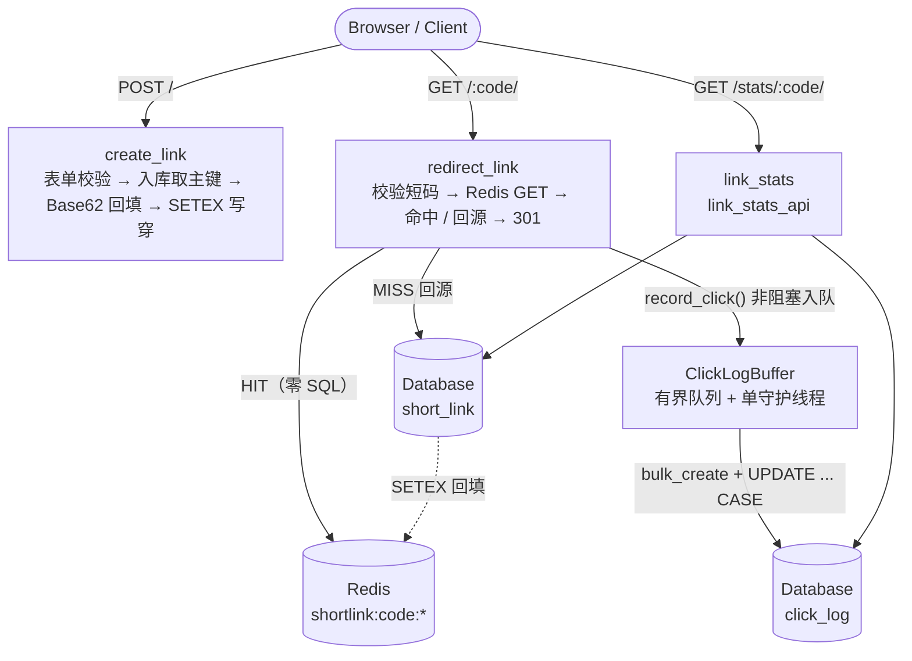

<div align="center">

# ShortLinkSystem

**一个面向读多写多场景的短链接服务：Redis 缓存优先、Base62 无碰撞短码、点击日志异步批量落库、ECharts 数据看板。**


</div>

---

## 目录

- [项目简介](#项目简介)
- [技术栈](#技术栈)
- [核心架构设计](#核心架构设计)
  - [整体链路](#整体链路)
  - [缓存优先策略](#缓存优先策略)
  - [降级策略](#降级策略)
  - [Base62 短码算法](#base62-短码算法)
  - [异步点击日志](#异步点击日志)
- [本地快速启动](#本地快速启动)
- [数据库表结构](#数据库表结构)
- [接口文档](#接口文档)
- [环境变量](#环境变量)
- [测试](#测试)
- [项目结构](#项目结构)
- [设计取舍与后续方向](#设计取舍与后续方向)

---

## 项目简介

ShortLinkSystem 是一个用 **Django 4.2** 实现的短链接系统。它不只完成“长链接变短链接”这一件事，
而是把短链服务真正的工程重点——**跳转延迟、缓存一致性、统计写入压力、数据可视化**——都做了一遍。

它的设计目标很明确：**跳转路径尽可能短，统计路径尽可能不拖慢跳转。**

- **高并发读路径**：短码跳转优先命中 Redis，命中时**不查询数据库**；未命中才回源并回填缓存。
- **Redis 缓存层**：`shortlink:code:<短码>` 命名空间 + 24 小时 TTL，写穿 + 回填双保险；
  响应头 `X-Shortlink-Cache: HIT / MISS` 可直接观测命中情况。
- **异步点击日志**：`queue.Queue` 有界队列 + 单守护线程，`bulk_create` + 一条 `UPDATE ... CASE`
  批量落库，200 条点击只产生 2 条 SQL，跳转请求**入队即返回**。
- **ECharts 可视化**：KPI 卡片 + 7 天点击趋势折线图 + 设备分布环形图 + 最近 20 条访问明细，
  数据由独立的 JSON 接口提供，可单独刷新。
- **降级优先**：Redis 全链路可选，宕机只记 warning 并回源数据库；队列满时丢弃统计事件而不是阻塞跳转；
  图表库加载失败时表格数据仍可阅读。

> 一句话总结：**Redis 是加速层，数据库才是真值；跳转不能被统计拖垮。**

---

## 技术栈

| 层次 | 技术 / 组件 | 版本 | 用途 |
| --- | --- | --- | --- |
| 语言 | Python | 3.10+（开发环境 3.13.2 验证） | 运行时 |
| Web 框架 | Django | 4.2 LTS | 路由、表单、模板、ORM、Admin |
| 缓存 | Redis + redis-py | Redis 5+（开发环境 5.0.14.1，推荐 7.x） | 短码 → 原始链接的热点缓存 |
| 数据库 | SQLite（通过 Django ORM） | 内置 | 短链映射与点击日志持久化（可平滑切换 MySQL / PostgreSQL） |
| 异步写入 | `queue.Queue` + `threading.Thread` | 标准库 | 进程内有界队列与单消费者批量落库 |
| 前端 | Bootstrap | 5.3.3（本地化） | 页面布局、卡片、响应式栅格 |
| 图标 | Bootstrap Icons | 1.11.3（本地化） | 看板与表单图标 |
| 图表 | Apache ECharts | 5.5.1（本地化） | 折线图（趋势）、环形图（设备分布） |
| 测试 | Django TestCase | 内置 | 91 个单元 / 集成测试 |
| 管理后台 | Django Admin | 内置 | 手工排查短链与点击日志 |

> 前端静态资源全部放在 `static/vendor/`，**没有外网也能完整渲染**，适合内网演示与离线环境。

---

## 核心架构设计

### 整体链路



**分层职责**

| 模块 | 职责 |
| --- | --- |
| `shortener/views.py` | 只做编排：取缓存、回源、响应、上下文组装 |
| `shortener/redis_client.py` | Redis 懒加载单例、缓存读写、异常降级与日志抑制 |
| `shortener/models.py` | 两张表与事务内的短码分配 |
| `shortener/utils.py` | Base62、URL 规范化、IP / UA 解析、设备归类 |
| `shortener/tasks.py` | 点击事件缓冲、批量落库、退出前排空 |
| `shortener/analytics.py` | 只读聚合：7 天趋势、设备分布、独立访客、payload 组装 |

### 缓存优先策略

跳转采用 **Cache-Aside + 写穿** 的组合：

| 时机 | 行为 | 代码位置 |
| --- | --- | --- |
| 创建短链成功后 | 立刻 `SETEX` 写穿缓存，第一次点击即可命中 | `views.create_link` |
| 跳转命中缓存 | 直接使用缓存里的 `url` 与 `id`，**零 SQL** | `views.redirect_link` |
| 跳转未命中 | 按 `short_code + is_active=True` 回源（`only()` 只取必要字段）并回填 | `views.redirect_link` |
| 缓存数据损坏 | JSON 解析失败按未命中处理，不影响跳转 | `redis_client.ShortLinkCache._decode` |
| 缓存键设计 | `shortlink:code:<短码>`，便于按命名空间排查与清理 | `redis_client.KEY_PREFIX` |

**缓存值同时保存主键**，这是有意设计：命中缓存时也能拿到 `link_id`，
异步写点击日志就不需要再回查数据库。

```json
{"id": 1, "url": "https://www.djangoproject.com/"}
```

- **TTL**：默认 `86400` 秒（24 小时），可通过 `SHORTLINK_CACHE_TTL` 调整。
- **旧格式兼容**：值若只是 URL 字符串，仍可跳转（此时 `link_id = 0`，视图会补一次主键并回填）。
- **可观测性**：每个跳转响应都带 `X-Shortlink-Cache: HIT | MISS`。
- **301 的坑**：跳转强制 `Cache-Control: no-store`，否则浏览器会长期缓存 301，
  后续点击不再经过服务端，统计会失真（生产环境可改为很短的 `max-age`）。

### 降级策略

系统的核心原则是：**任何非核心依赖出问题，都不能让跳转失败。**

| 故障场景 | 系统行为 | 用户感知 | 影响面 |
| --- | --- | --- | --- |
| Redis 未启动 / 连接超时 | 捕获 `RedisError`，返回 `None / False`，请求回源数据库 | 跳转正常，略微变慢 | 缓存命中率归零 |
| Redis 持续故障 | warning 每 30 秒最多一条，避免刷爆日志 | 无 | 仅日志可观测 |
| 缓存内容损坏 / 非 UTF-8 | 视为未命中并回源 | 无 | 无 |
| 点击日志队列满（默认 10000） | `put_nowait` 失败即丢弃并计数，**绝不阻塞跳转** | 跳转更快 | 少量统计丢失 |
| 批量写库失败 | 捕获异常、记 `failed_batches`，丢弃该批次 | 无 | 该批统计丢失 |
| 短码空间耗尽（> 62^6 − 1） | 抛出 `ShortCodeOverflow`，表单提示“联系管理员扩容” | 明确报错 | 无法创建新链接 |
| 图表库加载失败 / API 异常 | 卡片内显示提示；最近点击表格由后端直出 | 图表缺失，数据仍可读 | 仅可视化降级 |
| 数据库不可用 | `/healthz/` 返回 `503` + `unhealthy` | 健康检查失败 | 核心依赖不可用 |
| Redis 不可用 | `/healthz/` 返回 `200` + `cache_degraded: true` | 服务仍可用 | 仅标记降级 |

> 设计取向：**Redis 是可选加速层，数据库是唯一真值来源。**

### Base62 短码算法

短码不是随机串，而是**自增主键的 Base62 编码**，因此 ID 与短码之间是**双射**：
不同的 ID 一定得到不同的短码，**天然无碰撞、无需重试**。

```text
字母表：0-9 a-z A-Z（62 个字符，顺序固定，改动会导致历史短码无法解码）
左补字符：'0'，最小长度 4 位，最大长度 6 位
```

| 自增 ID | 短码 | 说明 |
| --- | --- | --- |
| `1` | `0001` | 最小长度补零 |
| `62` | `0010` | `62 = 1 × 62 + 0` |
| `238328` | `1000` | `62^3` |
| `56,800,235,583` | `ZZZZZZ` | 容量上限（`62^6 - 1`） |
| `56,800,235,584` | — | 抛 `ShortCodeOverflow` |

**实现要点**

1. `encode_base62(n, min_length=4)` 用 `divmod(number, 62)` 反复取余，再反转拼接并左补 `0`。
2. `decode_base62(code)` 反向累加，遇到非法字符抛 `ShortCodeError`（便于运维用短码反查 ID）。
3. 短码必须**先拿到自增主键**，因此 `short_code` 允许 `NULL`：事务内 `INSERT` → 计算 → `UPDATE` 回填，
   唯一索引允许多个 `NULL`，不会互相冲突。
4. 代码仍保留一次冲突探测（`_unique_short_code`），用于兼容历史数据或手工导入，属于兜底而非主路径。
5. 跳转路由用正则 `[0-9a-zA-Z]{4,6}` 约束短码，非法短码直接 404，不查库。

**容量**：`62^6 - 1 = 56,800,235,583` 条链接，足以支撑绝大多数业务规模。

### 异步点击日志

短链是“读多 + 写多”的场景。如果同步 `INSERT` 点击日志，数据库抖动会直接放大跳转尾延迟，
热点短链还会争抢同一行 `click_count` 的锁。因此统计链路被完全拆到请求之外：

```text
request ──submit()──▶ queue.Queue(maxsize=10000) ──▶ single daemon thread ──▶ batch flush ▶ DB
```

- 队列满：`put_nowait` 立即失败，丢弃事件并计数，**绝不阻塞跳转**。
- 批量写：200 条点击 = 1 条 `bulk_insert` + 1 条 `UPDATE ... CASE`（共 2 条 SQL）。

| 机制 | 参数 / 行为 |
| --- | --- |
| 入队 | `put_nowait`，队列满立即丢弃并累计 `dropped`，每丢 100 条告警一次 |
| 批次 | 默认最多 200 条，或每 1.0 秒强制刷一次（先到者触发） |
| 落库 | `bulk_create(ignore_conflicts=True)` + 一条 `UPDATE ... CASE WHEN` 累加 `click_count` |
| 生命周期 | 守护线程随进程退出；`atexit` 注册 `stop()`，退出前排空队列 |
| 连接管理 | 每批写库前 `close_old_connections()`，避免长连接失效 |
| 可替换性 | `record_click()` 是唯一入口，后续可无痛替换为 Celery / Kafka producer |

> 结果：跳转路径上**只有一次 Redis GET（命中）或一次 DB 查询 + 一次 SETEX（未命中）**，
> 统计写入完全异步化。

---

## 本地快速启动

### 0. 环境要求

| 依赖 | 是否必需 | 版本建议 | 说明 |
| --- | --- | --- | --- |
| Python | ✅ 必需 | 3.10+ | 使用标准库 `queue` / `threading`，无额外异步框架 |
| pip / venv | ✅ 必需 | 随 Python 提供 | 安装依赖 |
| Redis | ⭕ 可选 | 6.x / 7.x | 不启动也能跑，只是每次跳转都回源数据库 |
| Docker | ⭕ 可选 | 任意 | 用于一条命令拉起 Redis |

### 1. 获取代码并安装依赖

```bash
git clone <your-repo-url> ShortLinkSystem
cd ShortLinkSystem

# 创建虚拟环境
python -m venv .venv

# Windows PowerShell
.\.venv\Scripts\Activate.ps1
# macOS / Linux
# source .venv/bin/activate

# 安装依赖（Django 4.2 + redis-py 5.x）
python -m pip install --upgrade pip
python -m pip install -r requirements.txt
```

### 2. 启动 Redis（可选，但强烈建议）

```bash
# 方式 A：Docker（推荐，版本可控）
docker run -d --name shortlink-redis -p 6379:6379 redis:7

# 方式 B：本机已安装 Redis
redis-server

# 方式 C：Windows 下使用 WSL / Memurai / Redis for Windows 均可
```

启动后自检连通性（未连通时输出 `[FAIL]` 并提示服务仍可启动；该命令只做人工自检，退出码不用于 CI 探针）：

```bash
python manage.py check_redis
python manage.py check_redis --sample 10   # 额外打印 10 个缓存 key 及其 TTL
```

### 3. 初始化数据库

```bash
python manage.py migrate
```

> 默认使用项目根目录的 `db.sqlite3`（已内置演示库，可直接删除后重新迁移）。
> 切换 MySQL / PostgreSQL 只需修改 `config/settings.py` 中的 `DATABASES`，业务代码无需改动。

### 4. 运行测试

```bash
python manage.py test shortener              # 91 个测试，全部不依赖本地 Redis
python manage.py test shortener -v 2         # 查看每个用例名
```

### 5. 造演示数据（可选）

```bash
# 默认：50 条点击 / 最近 7 天 / 覆盖 PC、移动端、其他
python manage.py seed_demo_clicks

# 自定义：200 条点击、跨 14 天
python manage.py seed_demo_clicks --clicks 200 --days 14

# 指定短码，并先清空该短链的历史日志
python manage.py seed_demo_clicks --code 0001 --clear
```

| 参数 | 默认值 | 说明 |
| --- | --- | --- |
| `--clicks` | `50` | 写入的点击日志条数 |
| `--days` | `7` | 时间跨度（越靠近今天权重越高，趋势线更好看） |
| `--code` | 空 | 目标短码，留空取最新一条短链 |
| `--clear` | 关闭 | 写入前清空该短链已有日志 |
| `--seed` | `20261023` | 随机种子，保证演示数据可复现 |

> 库为空时会自动创建一条演示短链 `https://www.djangoproject.com/`。
> 该命令**仅用于演示**，生产环境请勿执行。

### 6. 启动服务

```bash
python manage.py runserver 0.0.0.0:8000
```

| 页面 | 地址 |
| --- | --- |
| 创建短链首页 | http://127.0.0.1:8000/ |
| 数据看板 | http://127.0.0.1:8000/stats/&lt;短码&gt;/ |
| 看板 JSON 接口 | http://127.0.0.1:8000/stats/&lt;短码&gt;/api/ |
| 健康检查 | http://127.0.0.1:8000/healthz/ |
| 管理后台 | http://127.0.0.1:8000/admin/ |

可选：创建后台账号（可查看 / 搜索短链与点击日志；点击日志禁止手工新增，字段只读）

```bash
python manage.py createsuperuser
```

### 7. 一条命令验证缓存

```bash
# 创建一条短链后，用返回的短码替换 <code>
curl -D - "http://127.0.0.1:8000/<code>/" -o NUL      # Windows
curl -D - "http://127.0.0.1:8000/<code>/" -o /dev/null # macOS / Linux
```

期望看到：

```http
HTTP/1.1 301 Moved Permanently
Location: https://www.djangoproject.com/
Cache-Control: no-store
X-Shortlink-Cache: MISS      # 第一次回源
```

再次请求同一短码，`X-Shortlink-Cache` 应变为 `HIT`。

---

## 数据库表结构

数据库通过 Django ORM 管理（迁移文件：`shortener/migrations/0001_initial.py`），共 **两张表**，
关系为 `short_link 1 ── N click_log`。

### `short_link` — 短链映射与累计点击

| 字段 | 类型 | 约束 / 默认值 | 说明 |
| --- | --- | --- | --- |
| `id` | `bigint` | 主键，自增 | 短码的来源（Base62 编码输入） |
| `original_url` | `varchar(2048)` | 非空 | 规范化后的原始链接（仅 http / https） |
| `short_code` | `varchar(6)` | 唯一，允许 `NULL` | 4~6 位 Base62 短码；先 INSERT 后回填 |
| `click_count` | `bigint` | 约束 `>= 0`，默认 `0` | 累计点击次数，由异步线程批量累加 |
| `is_active` | `boolean` | 默认 `true` | 关闭后跳转返回 404 |
| `created_at` | `datetime` | 自动写入，建索引 | 创建时间，默认按倒序展示 |

**索引 / 排序**

- 唯一索引：`short_code`（跳转查询与后台搜索的主入口）。
- 普通索引：`created_at`（首页“最近创建”与后台 `date_hierarchy`）。
- 默认排序：`-created_at`（最新创建的短链排在最前）。

> `short_code` 之所以允许 `NULL`：短码依赖自增主键，必须先 `INSERT` 拿到 `id` 再回填。
> SQLite / MySQL / PostgreSQL 的唯一索引都允许多个 `NULL`，不会互相冲突。

### `click_log` — 点击明细

| 字段 | 类型 | 约束 / 默认值 | 说明 |
| --- | --- | --- | --- |
| `id` | `bigint` | 主键，自增 | 日志 ID |
| `link_id` | `bigint` | 外键 → `short_link.id`，`ON DELETE CASCADE` | 关联短链，删除短链时级联删除 |
| `ip_address` | `varchar(39)` / `inet` | 允许 `NULL` | 客户端 IP（IPv4 / IPv6，取不到则为 `NULL`） |
| `user_agent` | `varchar(512)` | 非空，默认 `""` | 截断到 512 字符，用于设备分布统计 |
| `created_at` | `datetime` | 自动写入，建索引 | 点击时间（看板按本地时区分组） |

**索引**

| 索引名 | 字段 | 用途 |
| --- | --- | --- |
| `idx_click_link_time` | `(link_id, created_at DESC)` | 某条短链的最近点击、7 天趋势聚合 |
| `click_log_link_id_*` | `(link_id)` | Django 外键自动索引，按短链过滤 |
| `click_log_created_at_*` | `(created_at)` | 全局时间范围过滤 / 后台筛选 |

> 点击明细由后台线程 `bulk_create` 写入，管理后台中的 `ClickLog` **禁止手工新增、字段只读**
> （`has_add_permission` 返回 `False`），避免人工录入破坏统计口径。

---

## 接口文档

### 路由总览

| Method | Path | 视图 | 返回类型 | 说明 |
| --- | --- | --- | --- | --- |
| `GET` | `/` | `create_link` | HTML | 创建页（表单 + 最近 5 条短链） |
| `POST` | `/` | `create_link` | HTML | 提交长链接，成功后渲染结果页 |
| `GET` | `/<code>/` | `redirect_link` | `301` | 短码跳转（`code` 为 4~6 位 Base62） |
| `GET` | `/stats/<code>/` | `link_stats` | HTML | 数据看板页面 |
| `GET` | `/stats/<code>/api/` | `link_stats_api` | JSON | 看板图表数据 |
| `GET` | `/healthz/` | `health_check` | JSON | 健康检查（DB 必需 / Redis 可选） |
| `GET` `POST` | `/admin/` | Django Admin | HTML | 后台管理（需超级用户） |

> 路由顺序很重要：`/stats/...`、`/healthz/` 等静态路径必须排在短码通配 `/<code>/` 之前，
> 否则会被当成短码去查库（见 `shortener/urls.py`）。

### 1. 创建短链接

```http
POST /
Content-Type: application/x-www-form-urlencoded
X-CSRFToken: <csrf-token>

original_url=https://example.com/very/long/path?utm_source=demo
```

| 字段 | 类型 | 必填 | 校验规则 |
| --- | --- | --- | --- |
| `original_url` | string | ✅ | 最长 2048；仅允许 `http` / `https`；省略协议时自动补 `http://`；scheme 与 host 统一小写；拒绝 `javascript:`、`ftp:` 等协议 |

**成功响应**：`200 text/html`，渲染结果页，包含：

| 上下文 | 示例 |
| --- | --- |
| `link.short_code` | `0001` |
| `short_url` | `http://127.0.0.1:8000/0001/`（或 `SHORTLINK_BASE_URL` 拼接） |
| `stats_url` | `http://127.0.0.1:8000/stats/0001/` |

**失败响应**：`200 text/html`，回到表单并展示字段错误，例如：

```text
仅支持 http / https 链接，收到 ftp
链接缺少域名
```

### 2. 短码跳转

```http
GET /0001/
```

**成功响应**

```http
HTTP/1.1 301 Moved Permanently
Location: https://www.djangoproject.com/
Cache-Control: no-store
X-Shortlink-Cache: HIT
Content-Type: text/html; charset=utf-8
```

| 响应头 | 取值 | 说明 |
| --- | --- | --- |
| `Location` | 原始链接 | 301 目标地址 |
| `Cache-Control` | `no-store` | 防止浏览器长期缓存 301 导致统计失真 |
| `X-Shortlink-Cache` | `HIT` / `MISS` | 本次是否命中 Redis，便于压测与排障 |

**短码不存在 / 已停用**：`404 text/html`，渲染 `link_not_found.html`。
非法短码（长度不在 4~6 或含非 Base62 字符）直接 404，**不查库**。

### 3. 数据看板页面

```http
GET /stats/0001/
```

返回 `200 text/html`，页面包含：

| 区块 | 内容 |
| --- | --- |
| KPI 卡片 | 累计点击、近 7 天点击、独立 IP、设备占比最高项 |
| 趋势图 | ECharts 折线图（最近 7 天，缺失日期补 0） |
| 设备图 | ECharts 环形图（PC / 移动端 / 其他） |
| 最近明细 | 后端直出最近 20 条点击（IP、设备、UA、时间），JS 失效也可读 |

短码不存在时返回 `404`。

### 4. 看板数据接口（JSON）

```http
GET /stats/0001/api/
Accept: application/json
```

**成功响应** `200 application/json`（`Cache-Control: no-store`，UTF-8 不转义中文）：

```json
{
  "short_code": "0001",
  "original_url": "https://www.djangoproject.com/",
  "generated_at": "2026-10-23T15:20:00+08:00",
  "summary": {
    "click_count": 50,
    "unique_visitors": 31,
    "created_at": "2026-10-23T15:10:00+08:00"
  },
  "trend": {
    "days": 7,
    "labels": ["2026-10-17", "2026-10-18", "2026-10-19", "2026-10-20", "2026-10-21", "2026-10-22", "2026-10-23"],
    "values": [3, 5, 6, 8, 9, 9, 10],
    "total": 50
  },
  "devices": {
    "keys": ["pc", "mobile", "other"],
    "labels": ["PC", "移动端", "其他"],
    "values": [17, 29, 4],
    "total": 50,
    "top": "mobile",
    "top_label": "移动端"
  }
}
```

| 字段 | 类型 | 说明 |
| --- | --- | --- |
| `summary.click_count` | int | 累计点击（`short_link.click_count`） |
| `summary.unique_visitors` | int | 独立 IP 数（IP 为空的记录不计入） |
| `trend.labels` | string[] | 最近 7 天日期，**长度固定、缺失补 0** |
| `trend.values` | int[] | 与 `labels` 一一对应的每日点击量 |
| `trend.total` | int | 窗口内点击总和 |
| `devices.keys` | string[] | 固定为 `["pc", "mobile", "other"]`，顺序稳定 |
| `devices.top` | string \| null | 点击最多的设备类型；无数据时为 `null` |

**短码不存在** `404 application/json`：

```json
{"detail": "短链接 zzzz 不存在"}
```

> 统计口径：`TruncDate` 按 `TIME_ZONE`（默认 `Asia/Shanghai`）分组；
> 设备分布先按 `user_agent` 分组去重，再在 Python 侧归类，避免数据库正则方言差异。

### 5. 健康检查

```http
GET /healthz/
```

**正常响应** `200`

```json
{"status": "ok", "database": true, "redis": true, "cache_degraded": false}
```

**Redis 不可用（降级但服务可用）** `200`

```json
{"status": "ok", "database": true, "redis": false, "cache_degraded": true}
```

**数据库不可用** `503`

```json
{
  "status": "unhealthy",
  "database": false,
  "redis": true,
  "cache_degraded": false,
  "database_error": "..."
}
```

### 6. 状态码约定

| 状态码 | 场景 | 响应体 |
| --- | --- | --- |
| `200` | 页面 / JSON 正常返回、表单校验失败 | HTML / JSON |
| `301` | 短码跳转成功 | 空（`Location` 指向原始链接） |
| `404` | 短码非法、短链不存在或已停用 | HTML（页面）/ JSON（API） |
| `405` | 使用了不允许的 HTTP 方法（视图均为 `@require_GET` / `@require_http_methods`） | Django 默认 |
| `503` | 数据库不可用 | JSON（`/healthz/`） |

### 7. 快速调用示例

```bash
# 短链创建走 HTML 表单 + CSRF，建议直接用浏览器打开首页操作
# 查看跳转与缓存状态（Windows 下把 -o /dev/null 换成 -o NUL）
curl -sD - -o /dev/null http://127.0.0.1:8000/0001/

# 拉取看板数据（格式化输出）
curl -s http://127.0.0.1:8000/stats/0001/api/

# 健康检查
curl -s http://127.0.0.1:8000/healthz/
```

---

## 环境变量

所有外部依赖参数均可通过环境变量覆盖，**无需改代码**（见 `config/settings.py`）。

| 变量 | 默认值 | 说明 |
| --- | --- | --- |
| `DJANGO_SECRET_KEY` | 内置开发值 | 生产环境必须覆盖 |
| `DJANGO_DEBUG` | `True` | `1` / `true` / `yes` / `on` 视为开启 |
| `DJANGO_ALLOWED_HOSTS` | `127.0.0.1,localhost` | 逗号分隔 |
| `DJANGO_CSRF_TRUSTED_ORIGINS` | 空 | 逗号分隔，如 `https://short.example.com` |
| `REDIS_HOST` | `127.0.0.1` | Redis 地址 |
| `REDIS_PORT` | `6379` | Redis 端口 |
| `REDIS_DB` | `0` | Redis 库号 |
| `REDIS_PASSWORD` | 空 | 空字符串会被转成 `None` |
| `REDIS_SOCKET_TIMEOUT` | `0.5` | 读写超时（秒），跳转路径必须短 |
| `REDIS_CONNECT_TIMEOUT` | `0.5` | 连接超时（秒） |
| `SHORTLINK_CACHE_TTL` | `86400` | 缓存 TTL（秒） |
| `SHORTLINK_BASE_URL` | 空 | 对外短链域名；为空则用请求 Host |
| `CLICK_LOG_ASYNC` | `True` | `False` 时同步写日志（测试 / 排障用） |
| `CLICK_LOG_BATCH_SIZE` | `200` | 单批最大条数 |
| `CLICK_LOG_FLUSH_INTERVAL` | `1.0` | 后台线程刷盘间隔（秒） |
| `CLICK_LOG_QUEUE_MAXSIZE` | `10000` | 队列上限，满则丢弃并告警 |
| `SHORTENER_LOG_LEVEL` | `INFO` | `shortener` logger 级别 |

**生产环境最小配置示例**

```bash
DJANGO_DEBUG=0
DJANGO_SECRET_KEY=<random-64-chars>
DJANGO_ALLOWED_HOSTS=short.example.com
DJANGO_CSRF_TRUSTED_ORIGINS=https://short.example.com
SHORTLINK_BASE_URL=https://short.example.com
REDIS_HOST=redis.internal
REDIS_PASSWORD=<password>
```

---

## 测试

```bash
python manage.py test shortener
```

```text
Found 91 test(s).
System check identified no issues (0 silenced).
Ran 91 tests in 0.289s

OK
```

| 测试文件 | 用例数 | 覆盖内容 |
| --- | --- | --- |
| `tests/test_utils.py` | 29 | Base62 已知向量 / 双射 / 边界 / 溢出、URL 规范化、IP 与 UA 解析、设备分类 |
| `tests/test_views.py` | 20 | 创建 / 301 跳转 / 缓存命中与回源 / 404 / 看板 / JSON 接口 / 健康检查 / 方法限制 |
| `tests/test_cache.py` | 14 | 缓存读写、TTL、脏数据与旧格式、`get_many`、Redis 宕机全量降级 |
| `tests/test_analytics.py` | 10 | 7 天趋势补零、本地时区分组、窗口外过滤、设备分布、payload 结构 |
| `tests/test_models.py` | 9 | 短码生成、唯一性、级联删除、`active()` 查询集 |
| `tests/test_tasks.py` | 9 | 批量落库、点击累加、队列满丢弃、写库失败兜底、真实后台线程 |
| **合计** | **91** | — |

**测试不依赖本地 Redis**：`tests/fakes.py` 提供 `FakeRedisClient` 与 `BrokenRedisClient`，
通过 `set_redis_client()` 注入，既验证正常路径，也验证宕机降级路径。

---

## 项目结构

```text
ShortLinkSystem/
├── manage.py
├── requirements.txt              # Django 4.2 + redis-py 5.x
├── db.sqlite3                    # 默认 SQLite（演示数据）
├── README.md
├── config/                       # 项目配置
│   ├── settings.py               # 环境变量、DB、Redis、日志
│   ├── urls.py                   # admin + shortener
│   ├── asgi.py
│   └── wsgi.py
├── shortener/                    # 业务应用
│   ├── models.py                 # ShortLink / ClickLog
│   ├── views.py                  # 创建、跳转、看板、JSON API、健康检查
│   ├── urls.py                   # 路由（静态路径优先于短码）
│   ├── forms.py                  # 短链表单（URL 校验）
│   ├── utils.py                  # Base62 / URL 规范化 / IP / UA / 设备
│   ├── redis_client.py           # Redis 懒加载单例 + 缓存封装 + 降级
│   ├── tasks.py                  # 点击日志有界队列 + 批量落库
│   ├── analytics.py              # 看板只读聚合
│   ├── admin.py                  # 后台管理
│   ├── migrations/
│   ├── management/commands/
│   │   ├── check_redis.py        # Redis 连通性 + 缓存条目统计
│   │   └── seed_demo_clicks.py   # 演示点击数据
│   ├── templates/shortener/      # base / index / result / stats / 404
│   └── tests/                    # 91 个测试 + Redis 假实现
└── static/
    └── vendor/                   # Bootstrap 5.3.3 / Icons 1.11.3 / ECharts 5.5.1
```

---

## 设计取舍与后续方向

| 现状 | 取舍 / 后续 |
| --- | --- |
| 进程内有界队列 | 单机简单可靠、零外部依赖；多实例部署时建议替换为 Celery / Kafka（`record_click()` 是唯一入口） |
| 进程退出可能丢掉未刷盘事件 | `atexit` 会尽量排空队列；强一致场景需改成持久化队列 |
| 短链修改后缓存不会自动失效 | 目前无编辑 / 删除 API；后台改数据后可调用 `shortlink_cache.delete(code)` 或等待 TTL |
| SQLite 单机写入 | 高并发写入建议切 PostgreSQL / MySQL，并把 `CLICK_LOG_BATCH_SIZE` 与连接池一起调优 |
| 公开创建与查看 | 当前无登录 / 限流；公网部署前建议加鉴权、频率限制与 URL 黑名单 |
| 短码不可自定义、无过期时间 | 可在 `ShortLink` 上扩展 `expires_at` / `custom_code` 字段，跳转时统一校验 |
| 301 + `no-store` | 保证统计真实；若追求极致性能可改为 `302` 或允许短 `max-age` |
| 单进程内多个 worker | 每个进程各自持有 Redis 客户端与日志队列，属于预期行为；缓存与数据库共享 |

> 生产部署清单：`collectstatic`、关闭 `DEBUG`、配置 `ALLOWED_HOSTS` / `CSRF_TRUSTED_ORIGINS`、
> 使用 Gunicorn / uWSGI、为 Redis 设置密码与超时、接入监控采集 `/healthz/`。

---

## 许可证

仓库目前**未包含 `LICENSE` 文件**。如需对外开源，建议补充 MIT / Apache-2.0 等许可证，
并在 `README` 顶部同步许可证徽章。

<div align="center">

**如果这个项目对你有帮助，欢迎 Star ⭐**

</div>


